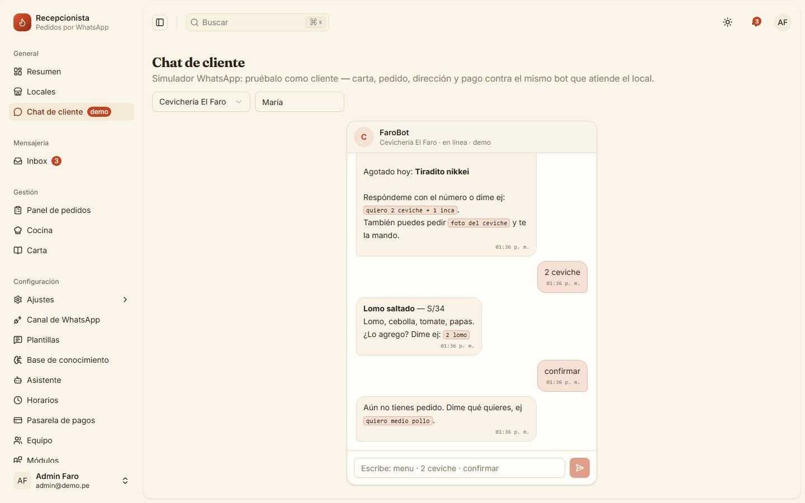
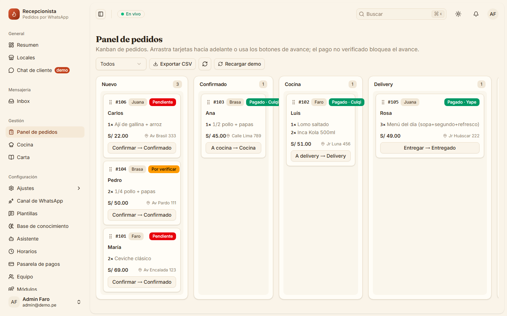
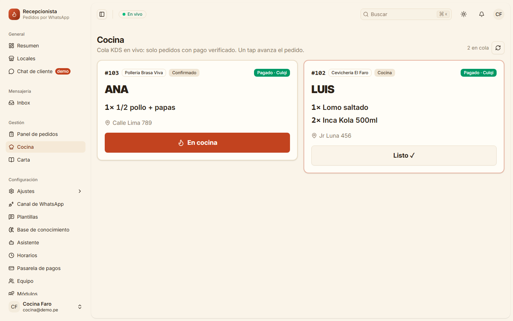

# Recepcionista — SaaS de pedidos por WhatsApp para restaurantes

Reemplaza al recepcionista de un local de comida peruano: el cliente pide por WhatsApp,
un bot con NLU determinista arma el pedido, cobra (Culqi sandbox o QR Yape, verificado
server-side) y empuja los tickets al Kanban del dueño y al KDS de la cocina.

Tres tenants demo: **faro** (cevichería), **brasa** (pollería) y **juana** (menú criollo).
Base conceptual: AgentKit + chatalog + GinoRobla.

## Pantallas

<p>
  
  
</p>
<p>
  
</p>

*Capturas del demo sandbox (`POST /api/demo/reset`): pedidos, platos y cuentas ficticias.*

## Características

- **Bot de WhatsApp** sobre Meta Cloud API (webhook verificado; túnel cloudflared en el docker-compose).
- **Cerebro híbrido**: NLU determinista dueña del estado de la conversación; el LLM solo
  redacta lo que el NLU no clasifica. Nunca inventa precios (fuente: `menu.yaml`).
- **Pagos verificados server-side**: cargo real en Culqi sandbox (webhook) y QR Yape con
  match de monto exacto. Regla anti-fraude: *screenshot de voucher nunca = pagado*.
- **Kanban del dueño** (Nuevo/Confirmado/Cocina/Delivery) y **KDS** de cocina.
- **Multi-tenant** con roles (patrón Chatwoot), planes y trial.
- **Secretos de integración cifrados en BD** (Fernet).

## Stack

FastAPI · SQLModel · SQLite · React 19 + Vite + TanStack Router/Query · shadcn/ui ·
Docker (app + cloudflared) · pytest (216 funciones de test) · GitHub Actions CI

## Correr el backend

```powershell
pip install -r backend/requirements.txt
python -m uvicorn backend.app.main:app --reload --port 8000
```
Abrir http://127.0.0.1:8000

## Frontend

```bash
cd frontend
npm install
npm run dev   # http://localhost:5173 con proxy /api -> :8000
```

## Pago real (Culqi sandbox, opcional)

Sin llaves, el botón "Culqi (SIMULADO)" marca pagado a propósito para demostrar la regla
anti-fraude. Con llaves de prueba, el botón "Pagar con tarjeta" crea un cargo REAL en
Culqi sandbox (tarjeta de test 4111 1111 1111 1111) verificado server-side:
```powershell
$env:CULQI_PUBLIC_KEY="pk_test_..."
$env:CULQI_SECRET_KEY="sk_test_..."
python -m uvicorn backend.app.main:app --port 8000
```
El QR de Yape es demo escaneable (sandbox); la verificación sigue siendo monto exacto.

## Rutas de la app

El backend sirve el build del frontend (SPA React + TanStack Router) además del API:

* `/cliente` — simulador del chat del cliente (RAG de la carta, carrito, pago)
* `/panel` — Kanban del dueño (Nuevo/Confirmado/Cocina/Delivery)
* `/cocina` — KDS de cocina (cola y estados de preparación)
* `/carta` — administración de la carta (toggle, precios)
* `/locales`, `/mensajeria`, `/configuracion` — gestión del tenant
* `/sign-in` — login con cuentas demo listas para probar

## API prototipo

* `GET /api/tenants` `GET /api/menu?tenant=faro`
* `POST /api/chat` {tenant, customer, message} -> {reply, cart, order_id}
* `GET /api/track?tenant=&cliente=` estado real de los pedidos por nombre
* `POST /api/orders` `GET /api/orders?tenant=` `PATCH /api/orders/{id}`
* `POST /api/payments/culqi/link` (sandbox, no dinero real)
* `POST /api/payments/culqi/webhook` {reference_id} -> marca PAID server-side
* `POST /api/payments/yape` {order_id, monto_foto, monto_real} -> PAID o pendiente_verificar (anti Yape-falso)
* `POST /api/demo/reset` recarga seed

## Reglas (papers)

* Screenshot nunca = pagado. Solo webhook verificado o match exacto Yape.
* RAG híbrido simple: keyword + categoría, nunca inventa precio.
* NLU determinista dueña del estado; el LLM solo redacta lo no clasificado.
* Dirección real: el chat la captura y queda en el pedido (visible en el Kanban).
* Tracking por nombre: el cliente pregunta y recibe estado/pago/total de verdad.
* Carta admin valida precios (0–9999) y reporta errores reales.

## Estructura

```
backend/
  app/               FastAPI (28 módulos): main, brain, bot, payments, whatsapp, crypto, ...
  tests/             pytest — 216 funciones de test en 11 archivos
  requirements.txt
  pyproject.toml     # ruff + pytest configurados
frontend/            React 19 + Vite + TanStack (base shadcn-admin); el backend sirve su build
static/              assets de la demo (imágenes)
docs/                DESIGN.md, PRODUCT.md, adr/, deploy.md, rotacion-secretos.md
openspec/            specs vigentes y changes en curso
.github/workflows/   CI
```
